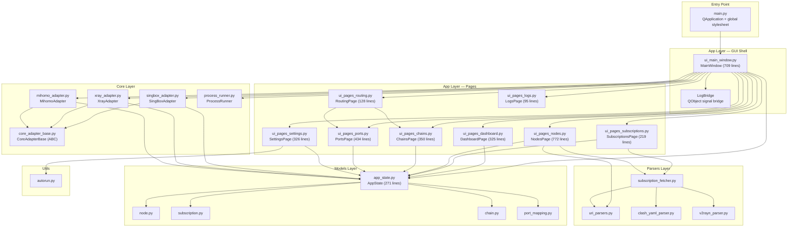
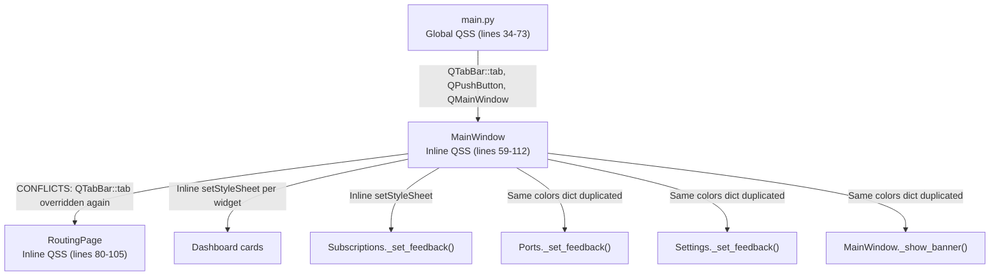
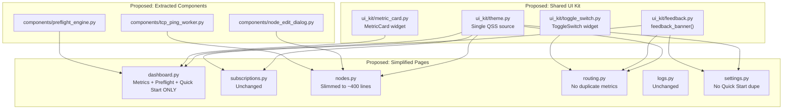
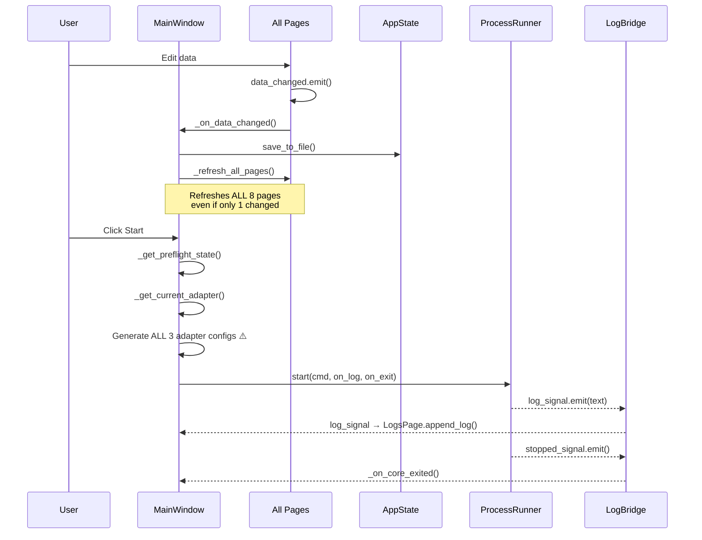

# ChainPort Gateway — Architecture Graph + UI/UX Deep Audit

> **Generated:** 2026-04-26 · **Scope:** Full repository `d:\Codes\Sing-chain`

---

## 1. Architecture Graph

---

## 2. Data Flow Pipeline

---

## 3. Stylesheet Cascade Conflict Map

---

## 4. UI/UX Caveman-Review Audit

### 🔴 Critical Bugs / Broken UX

`main.py:34-72` + `ui_main_window.py:59-112`: 🔴 **QSS cascade war.** Global stylesheet sets `QTabBar::tab:selected → border-bottom: 2px solid #3498db` (blue underline), then MainWindow overrides to `background: #1f4b99; color: white;` (filled tab). Both fight. RoutingPage adds a THIRD QTabBar style. The result is unpredictable rendering depending on Qt cascade resolution order. **Fix: Single source of truth for all QSS in one file/class.**

`ui_pages_dashboard.py:284-286`: 🔴 **Duplicate Apply/Start/Stop buttons.** Dashboard has its own Apply, Start, Stop, Open Sources, Open Routing, Open Activity — 6 action buttons that are 100% duplicates of the global action bar at bottom of MainWindow. Confuses users about which set is "real". **Fix: Remove dashboard action buttons; the global bar is always visible.**

`ui_pages_routing.py:64-76` + `ui_pages_dashboard.py:151-170`: 🔴 **Duplicate metrics display.** RoutingPage shows 4 stat cards (Chains, Bindings, TUN, Nodes Available). Dashboard shows 6 metric cards (Subscriptions, Nodes, Chains, Bindings, TUN, Runtime). 3 of these are identical data. User sees the same numbers in 2 places. **Fix: Routing page should NOT re-display what Dashboard already shows.**

### 🟡 Risk / Fragile Patterns

`ui_pages_subscriptions.py:207-218` + `ui_pages_ports.py:422-433` + `ui_pages_settings.py:314-325` + `ui_main_window.py:590-602`: 🟡 **`_set_feedback()` / `_show_banner()` copy-pasted 4 times.** Identical color dict, identical logic, identical CSS string template. Any color change must be synchronized across 4 files. **Fix: Extract to a shared `feedback_banner(label, message, level)` utility.**

`ui_pages_nodes.py:1-9`: 🟡 **Module docstring still in Chinese.** AGENTS.md mandates English-only UI text and new comments. Multiple files still have Chinese docstrings and inline comments (nodes, chains, logs, app_state). **Fix: Translate all remaining Chinese text to English.**

`ui_pages_nodes.py:272-772`: 🟡 **NodesPage is 772 lines — the largest UI file.** It contains `NodeEditDialog` (232 lines), `TcpPingWorker` (36 lines), and the page itself (500 lines). Three separate responsibilities crammed into one file. **Fix: Extract `NodeEditDialog` and `TcpPingWorker` into their own modules.**

`ui_pages_dashboard.py:231-233`: 🟡 **Misaki easter-egg text in production UI.** `"♡ Misaki is watching over your routes..."` is charming for dev but confusing for real users. **Fix: Remove or make configurable.**

`ui_pages_chains.py:39-58`: 🟡 **"Add SOCKS5 Exit" is a niche feature at TOP of Chains page.** Most users will never use "Wrap Socks5". It occupies premium real-estate above the chain list, pushing the actual chain management below the fold. **Fix: Move to a secondary action or advanced panel.**

`ui_main_window.py:506-512`: 🟡 **Generates ALL adapter configs on every start, regardless of selected core.** When user clicks Start with `sing-box` selected, code instantiates `SingBoxAdapter()`, `XrayAdapter()`, `MihomoAdapter()` and generates configs for all 3. Wasteful and confusing log output. **Fix: Only generate for the selected adapter.**

`ui_pages_dashboard.py:301-324` + `ui_main_window.py:692-708`: 🟡 **Preflight logic duplicated.** `MainWindow._get_preflight_state()` computes blockers/warnings, then `MainWindow._refresh_action_state()` passes them to Dashboard. Dashboard stores them AND re-runs `refresh_table()` inside `set_preflight_summary()`, which calls `refresh_table()` AGAIN (recursive refresh). **Fix: Single refresh path, no re-entrant calls.**

`ui_pages_settings.py:161-173`: 🟡 **"Quick Start" guide duplicated.** Settings page has a "Quick Start" section with 5 steps. Dashboard has a "Quick Start" section with 5 identical steps. Two copies of the same onboarding text. **Fix: Show Quick Start ONLY on Dashboard.**

### 🔵 Nits / Style Issues

`ui_pages_ports.py:20-62`: 🔵 **Custom `ToggleSwitch` widget (43 lines) for a single checkbox.** Over-engineered for one TUN toggle. Could use standard QCheckBox with custom stylesheet. Not reused elsewhere.

`main.py:31`: 🔵 **Hardcoded font "Microsoft YaHei UI".** Fails gracefully but non-ideal on systems without CJK fonts. **Fix: Use system default or cross-platform font stack.**

`ui_pages_routing.py:51-57`: 🔵 **Long intro paragraph nobody reads.** "Routing is where you turn raw nodes into usable traffic paths…" — 2 lines of text that adds no actionable information. **Fix: Remove or condense to a tooltip.**

`ui_pages_chains.py:67-68`: 🔵 **Chain list uses QListWidget with ExtendedSelection but hop editor uses single-selection implicitly.** Mixed selection paradigms confuse multi-select expectations.

`ui_pages_logs.py:92-94`: 🔵 **`refresh_table()` is a no-op.** Exists only to satisfy the interface contract. The uniform `refresh_table()` naming across all pages is a leaky abstraction — Logs doesn't have a table.

---

## 5. Duplication Heatmap

| Pattern | Occurrences | Files |
|---------|-------------|-------|
| `_set_feedback()` color dict + CSS | **4×** | subscriptions, ports, settings, main_window |
| `refresh_table()` method name | **8×** | All pages (even Logs where it's a no-op) |
| Quick Start steps (5-step guide) | **2×** | dashboard, settings |
| Apply/Start/Stop action buttons | **2×** | dashboard hero, main_window bottom bar |
| Metric cards (Chains, Bindings, TUN) | **2×** | dashboard, routing page |
| QSS `QTabBar::tab` styling | **3×** | main.py, main_window, routing page |
| Chinese comments/docstrings | **6+ files** | nodes, chains, logs, app_state, main.py |
| `import re` pattern matching for `{N-M}` | **2×** | nodes._on_batch_create_chain, chains._on_batch_rename |

---

## 6. File Size & Complexity Ranking

| File | Lines | Responsibility Count | Verdict |
|------|-------|---------------------|---------|
| `ui_pages_nodes.py` | 772 | 3 (Page + Dialog + Worker) | 🔴 **SPLIT** |
| `ui_main_window.py` | 709 | 5+ (Shell + Actions + Preflight + Tray + Admin) | 🟡 Extract preflight, tray |
| `ui_pages_ports.py` | 434 | 2 (Page + ToggleSwitch) | 🟡 Extract toggle |
| `ui_pages_chains.py` | 350 | 1 | ✅ OK |
| `ui_pages_dashboard.py` | 325 | 2 (Page + MetricCard) | ✅ OK (but remove duplicates) |
| `ui_pages_settings.py` | 326 | 1 | ✅ OK (but remove Quick Start dupe) |
| `ui_pages_subscriptions.py` | 219 | 1 | ✅ Clean |
| `ui_pages_routing.py` | 128 | 2 (Page + StatCard) | ✅ OK (but remove metric dupes) |
| `ui_pages_logs.py` | 95 | 1 | ✅ Clean |

---

## 7. Proposed Redesign Architecture

---

## 8. Redesign Action Items (Priority Order)

### P0 — Fix Broken UX (Do First)
1. **Eliminate QSS cascade war:** Consolidate all stylesheets into `ui_kit/theme.py`. Remove inline `setStyleSheet()` from `main.py`, `MainWindow`, and `RoutingPage`.
2. **Remove duplicate action buttons from Dashboard:** The global Apply/Start/Stop bar at the bottom of MainWindow is always visible. Dashboard should NOT have its own Apply/Start/Stop.
3. **Remove duplicate metric cards from Routing:** RoutingPage's stat cards repeat Dashboard data. Replace with a one-line summary label.
4. **Remove duplicate Quick Start from Settings:** Keep it only on Dashboard.

### P1 — Eliminate Code Duplication
5. **Extract `_set_feedback()` into shared utility:** Create `app/ui_kit/feedback.py` with a single `set_feedback_banner(label, message, level)` function.
6. **Extract `{N-M}` pattern-matching regex:** Used in both Nodes and Chains for batch operations. Create a shared `utils/pattern_rename.py`.
7. **Translate all Chinese comments/docstrings to English** per AGENTS.md policy.

### P2 — Structural Improvements
8. **Split `ui_pages_nodes.py`:** Extract `NodeEditDialog` → `app/dialogs/node_edit_dialog.py`, `TcpPingWorker` → `app/workers/tcp_ping_worker.py`.
9. **Extract preflight logic from MainWindow:** Move `_get_preflight_state()` to `components/preflight_engine.py`.
10. **Fix recursive refresh in Dashboard:** `set_preflight_summary()` calls `refresh_table()` which triggers downstream refreshes. Break the cycle.
11. **Move "Add SOCKS5 Exit" below chain list** or into a collapsible advanced section.
12. **Only generate config for the selected adapter** on Start, not all 3.

### P3 — Polish
13. **Remove Misaki easter-egg text** from production Dashboard.
14. **Replace hardcoded font** with cross-platform font stack.
15. **Rename `refresh_table()` to `refresh()`** across all pages (Logs doesn't have a table).
16. **Remove verbose intro paragraphs** from Routing and Dashboard that nobody reads.

---

## 9. Signal & Event Wiring Map

> [!WARNING]
> **`_refresh_all_pages()` refreshes ALL 8 pages on every single data change.** This is O(n) on node count × 8 pages. With 500+ nodes, each keystroke in the search box triggers 8 full table rebuilds. Should use targeted refresh.

---

## 10. Summary

| Category | Count |
|----------|-------|
| 🔴 Critical UX bugs | 3 |
| 🟡 Risks / Fragile patterns | 8 |
| 🔵 Nits | 5 |
| Code duplications found | 8 patterns |
| Files needing refactoring | 4 |
| Total redesign action items | 16 |
